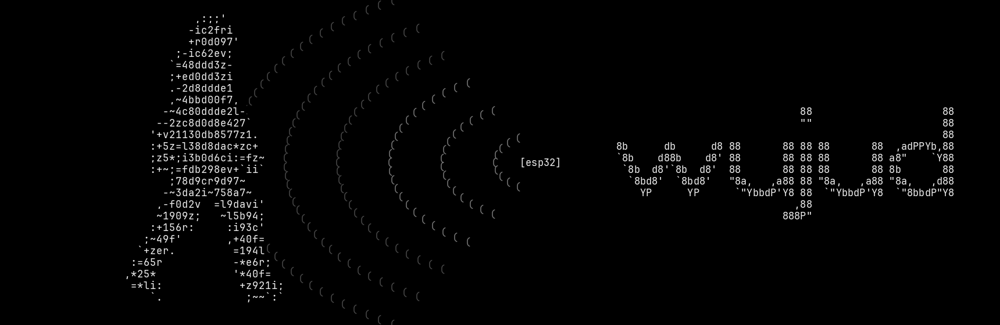

<p align="center"></p>

# wujud

wujud senses people with Wi-Fi channel state information (CSI) from a $5 ESP32. It tells:

- an empty room;
- a person holding still;
- a person moving.

Every model is trained on physics simulation. None of them has seen a labelled real sample.

- **No router needed.** The ESP32 opens its own network. Every phone or laptop that joins becomes one sensing link, and the board measures the CSI of its replies.
- **Native app.** A Rust and egui 3D view of the room, fed by the board over Wi-Fi or USB, or by the simulator.
- **Measured, not claimed.** Each result has a protocol and a number, including the ones that did not work. See `docs/FINDINGS.md` and `research/results/`.

## Layout

| path | what |
|---|---|
| `crates/proto` | the line protocol between board and host (`no_std`, shared with the firmware) |
| `crates/sim` | physics simulator: rooms, lecture halls, people, walls, ESP32 impairments |
| `crates/model` | features, gradient-boosted models (bit-exact with sklearn), occupancy latch, motion tracker |
| `crates/app` | the `wujud` program: live view, simulator demos, monitor, recording and replay |
| `crates/study` | limits study: which change in the hardware breaks the single-link limit |
| `research/firmware` | the ESP32 room firmware (Arduino) and `board.sh` to flash and control it over Wi-Fi |
| `research/rt` | GPU ray-traced CSI dataset (Sionna RT) |
| `research/` | the original Python implementation, benchmarks and results |
| `firmware/` | a Rust port of the firmware, not yet run on hardware |
| `docs/` | architecture guide, code conventions, findings |

## Run

You need a Rust toolchain. To see the simulator, no hardware required:

```bash
cargo run --release -p wujud -- demo --boards 3
```

To run with a real board:

1. Install the Arduino CLI and the ESP32 core.
2. Flash each board once over USB, all with the same firmware:
   ```bash
   research/firmware/board.sh flash
   ```
3. Switch the boards on. The first one opens the Wi-Fi network `wujud` and the others join it by themselves (`research/firmware/README.md`). Join the laptop to `wujud` too.
4. Start the live view:
   ```bash
   cargo run --release -p wujud -- live --ports udp:192.168.4.1
   ```
   Or keep the laptop on its own network and plug the hub in over USB: its serial carries every link (`--ports /dev/ttyACM0`).

When the hub can reach the home router it is also on the home network: read it there with `--ports udp:<its address>` and the laptop keeps its own Wi-Fi.

Nothing is trained on, measured in, or calibrated for the room it runs in:

- Where the boards stand: from how strongly they hear each other (RSSI, log-distance), as a triangle scaled into a bedroom, placed again after 30 s of signal. A phone left in the room joins as a fourth device: the four become a rectangle whose diagonals are the two pairs heard most weakly (an order, so a phone's different transmit power does not matter).
- Moving or not: how much each link's spectrum shape changes from one second to the next (`research/tools/drift_detector.py`), the links' median over five seconds against three times the room's own typical level. Tuned on a guided recording (`research/tools/guided_room.py`, every second labelled): walking 89-96%, sitting 93%, lying 94%, standing 100%. On ESPectre's public ESP32 recordings, rooms never seen in training: moving caught 98-100%.
- Where someone walks: a network trained on simulated rooms only (`research/tools/link_net.py`, `crates/app/src/link_net.rs`). Every pair of devices is one token, read together like the channels of a multichannel audio model: its disturbance and RSSI spread over its own quiet level, each subcarrier's spread and how the spectrum's shape moved, over three seconds. A transformer lets the pairs see each other, then every grid point attends over the pairs through how it sits relative to each (extra path, distance to the line, place along it, length) and is scored. On simulated rooms it never saw: 0.54 m median error with four devices (86% within 1 m), 0.71 m with three, against 0.86 m for the room's centre. Rooms are mirrored at random while learning, so it has no favourite spot. On real boards in a room it never saw, it follows the person. `WUJUD_TRACKER=points` uses the earlier network that scores each link on its own (`research/tools/learned_tracker.py`: 0.69 m with three devices, 0.61 m with four).
- Someone still: a body that does not move leaves the signal as an empty room does, so after someone moves they are taken to be there for ten minutes ("last moved 40 s ago"), then "no movement for N min". Measured on four rooms, no model told a still person from an empty room without first seeing the room empty (`research/tools/presence_model.py`: empty read right 0-49%).
- Breathing rate after about 30 still seconds (on the simulator: 0.2 /min median error when read, 84% within 2 /min, read in 40% of still seconds).
- Distance from each board: join a phone to `wujud` and keep it on you; each board's signal strength gives a distance (about ±1 m).
- A board switched on while the view is open joins it; nothing needs restarting.
- Against RuView in the same guided test: still-vs-moving 93% against 71%.

Run the tests, which include golden comparisons against the Python reference:

```bash
cargo test --workspace
```

## What we found

- **Motion is easy and presence is fine.** A person holding still versus an empty room is the hard case. On public ESP32 data (ESPectre), every single-link method we tried reaches an AUC of 0.55–0.65, and so do 31 deep networks.
- **Physical information breaks the limit, not bigger models.** In simulation, a 40 MHz channel, 100+ packets per second and a second link take the AUC from 0.64 to 0.97 (`research/results/limits`).
- **Two-antenna laptop Wi-Fi cards corrupt the CSI.** Their STBC frames make the CSI jump about 4.5 dB from packet to packet at a single-antenna ESP32. Phones measured 0.36 dB. The firmware keeps only non-STBC 802.11n frames.
- **Cheap routers answer the ESP32 in 802.11b.** Those frames have no CSI, which is why the firmware uses phones instead of the router.
- **The public dataset is confounded.** In ESPectre's holdout split, the receiver noise level alone separates still from empty with an AUC of 0.84, because the still-person recordings were made at weak signal.
